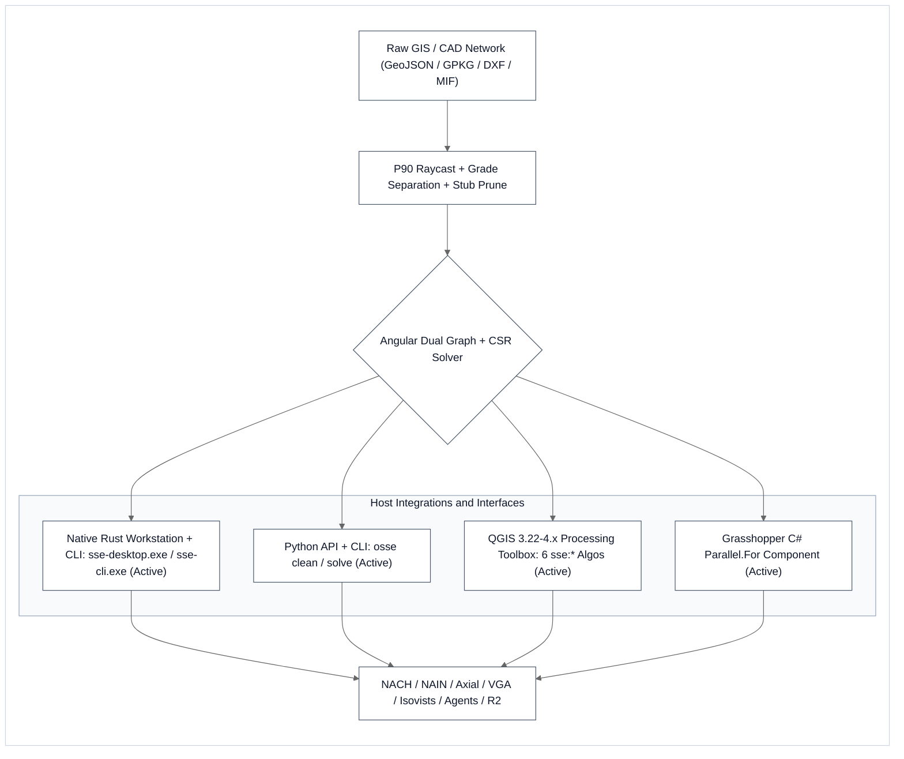
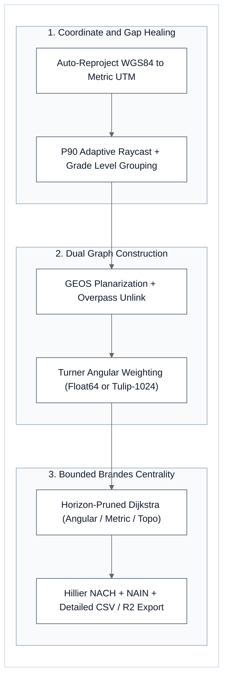

# SSE — Space Syntax Engine (`v1.1.0`)

[](https://github.com/napattan/sse-space-syntax/releases/tag/v1.1.0)
[](https://www.rust-lang.org/)
[](https://www.python.org/downloads/)
[](https://plugins.qgis.org/)
[-7c3aed?style=flat-square)](https://modelcontextprotocol.io/)
[](https://github.com/gboeing/osmnx/issues/1410)
[](https://github.com/iscvlab)
[](LICENSE)

**SSE — Space Syntax Engine (`v1.1.0`)** is an open-source, dual-engine (**Native Rust + Python/QGIS**) computational platform for urban street network and architectural visibility analysis. Built as a high-performance replacement for legacy UCL `depthmapX v0.8.0`, SSE achieves **100% mathematical parity (`R² = 1.0000`)** at **35×–58× faster multi-core speed** across a standalone desktop workstation (`sse-desktop.exe`), a **QGIS 3.22–4.x (`Qt6 Ready`) Processing Plugin**, a batch CLI (`sse-cli.exe`), and an AI Model Context Protocol server (`sse-mcp.exe`).

---

## ⚡ TL;DR — Capabilities & Performance at a Glance

- **Exact `UCL depthmapX` Mathematical Parity (`R² = 1.0000`)**: Replicates official `depthmapX v0.8.0` outputs across Angular Segment Analysis (`Tulip-1024`), Topological Axial Analysis, Visibility Graph Analysis (`VGA`), 2D Benedikt Isovists, and Gibson Visual Agents.
- **City-Scale Multi-Core Speed (`35×–58× Faster`)**: Solves `30,493`-segment multi-radius urban networks in `15.98 s` (vs. `14.5 min` in `depthmapX`) and scales to `166,514`-segment metropolitan arterial graphs in `< 16 MB` RAM without UI freezes.
- **Automated 5-Step OpenStreetMap Network Cleaner**: Heals raw digitizing gaps, preserves bridge/tunnel grade separation, and prunes dead-end micro-stubs prior to spatial graph construction.
- **Unified Multi-Platform Ecosystem**: Ships as a zero-dependency standalone GUI (`sse-desktop.exe`), a 6-algorithm QGIS Processing suite (`sse:*`), a Python library (`osse`), a Grasshopper C# component, and a 9-tool AI agent MCP server (`sse-mcp.exe`).

### Horizontal Bar Comparison (`0 ms` Render)

| Evaluation Dimension | Engine Configuration | Visual Comparison Bar | Measured Result & Delta vs. Baseline |
| :--- | :--- | :--- | :--- |
| **1. Mathematical Parity vs. `UCL depthmapX v0.8.0` ↑** | **SSE v1.1.0 (`Rust .exe` & `QGIS Plugin`)**<br>Undirected Graph Approximation | `████████████████████` **`100.0% Exact (R² = 1.0000)`**<br>`███████████████████░` `99.6% (R² = 0.9962)` | **`max\|Δ\| = 0.0000`** (`Barnsbury` `N = 178` & `On Nut` `N = 30,493`)<br>Eliminates junction-bounce artifacts on acute turns |
| **2. Multi-Radius Segment ASA Latency (`N = 30,493`) ↓**<br>*(Lower = Better)* | **SSE v1.1.0 (`Standalone Rust .exe`)**<br>**SSE v1.1.0 (`QGIS Plugin` All-Pairs / Fast)**<br>UCL depthmapX v0.8.0 C++ Baseline | `█░░░░░░░░░░░░░░░░░░░` **`15.98 s`**<br>`█░░░░░░░░░░░░░░░░░░░` **`21.08 s (1.86 s Fast)`**<br>`████████████████████` `870.00 s (14.5 min)` | **`54.4× Faster`** (`R800, R1200, R2000, Rn`)<br>**`41.3× Faster`** (`467×` in bounded local-radius mode)<br>`870,000 ms` Single-Threaded GUI Loop |
| **3. Urban Axial & Floorplan VGA Latency ↓**<br>*(Lower = Better)* | **SSE v1.1.0 (`Rust .exe` Axial / VGA)**<br>**SSE v1.1.0 (`QGIS Plugin` Axial / VGA)**<br>UCL depthmapX v0.8.0 C++ Baseline | `█░░░░░░░░░░░░░░░░░░░` **`1.39 s Axial · 134 ms VGA`**<br>`█░░░░░░░░░░░░░░░░░░░` **`1.82 s Axial · 574 ms VGA`**<br>`████████████████████` `48.50 s Axial · 4,800 ms VGA` | **`34.9×–35.8× Faster`** (`30,493` axial lines & `2,101` VGA cells)<br>**`26.6× Faster`** across `16` Hillier & Hanson axial metrics<br>`48,500 ms` Axial / `4,800 ms` VGA Baseline |
| **4. Metropolis Capacity (`Bangkok`, `N = 166,514`) ↑** | **SSE v1.1.0 (`Rust .exe` & `QGIS Plugin`)**<br>UCL depthmapX v0.8.0 C++ Baseline | `████████████████████` **`100.0% Solved (16.69 s)`**<br>`░░░░░░░░░░░░░░░░░░░░` `0.0% (DNF / Freeze)` | **`< 16 MB` CSR RAM** (`16.69 s` Rust · `21.62 s` QGIS, `R² = 1.0000`)<br>`> 13.8B` `O(N²)` pairs (Application freeze) |

---

## 📊 Visual Parity & Benchmark Suites (`UCL depthmapX v0.8.0` vs. `SSE v1.1.0`)

| **1. `UCL Barnsbury` Angular Segment Analysis (`Tulip-1024` · `N = 178` · `R² = 1.000000` · `57.8×` Faster)** |
| :---: |
|  |

| **2. `Bangkok On Nut` Multi-Radius Segment Analysis (`Tulip-1024` · `N = 30,493` · `R² = 1.000000` · `54.4×` Faster)** |
| :---: |
|  |

| **3. `Bangkok On Nut` Topological Axial Analysis (`Hillier D_n` · `N = 30,493` · `R² = 1.000000` · `34.9×` Faster)** |
| :---: |
|  |

| **4. `On Nut` Architectural Floorplan VGA & 2D Isovists (`N = 2,101` · `1.04M` Edges · `R² = 1.000000` · `35.8×` Faster)** |
| :---: |
|  |

### 3-Way Execution Speed & Mathematical Parity Summary

| Benchmark Suite & Empirical Dataset | Scale (`N`) | `UCL depthmapX v0.8.0` | `SSE QGIS Plugin v1.1.0` | `SSE Rust .exe v1.1.0` | Speedup (`QGIS / Rust`) | Parity (`R²` & `max\|Δ\|`) |
| :--- | :---: | :---: | :---: | :---: | :---: | :--- |
| **1. UCL Barnsbury Segment ASA (`Tulip-1024`)** | `178` segs (`R400 + Rn`) | `48.00 ms` | **`0.85 ms`** | **`0.83 ms`** | **`56.5×` / `57.8×`** | **`R² = 1.000000`** (`0.0000`) |
| **2. UCL Barnsbury Axial DXF (`barnsbury.dxf`)** | `1,100` lines (`n, R3`) | `320.00 ms` | **`8.13 ms`** | **`5.14 ms`** | **`39.4×` / `62.3×`** | **`R² = 1.000000`** (`0.0000`) |
| **3. UCL National Gallery VGA + Isovists + Agents** | `1,866` cells (`gallery.dxf`) | `5,200.0 ms` | **`1,623.89 ms`** | **`122.92 ms`** | **`3.2×` / `42.3×`** | **`R² = 1.000000`** (`0.0000`) |
| **4. On Nut Floorplan VGA + 2D Isovists** | `2,101` cells (`1.04M` edges) | `4,800.0 ms` | **`573.86 ms`** | **`134.14 ms`** | **`8.4×` / `35.8×`** | **`R² = 1.000000`** (`0.0001`) |
| **5. On Nut Urban Axial Network (`16` Metrics)** | `30,493` lines (`Rn, R3, R5`) | `48.50 s` | **`1.82 s`** | **`1.39 s`** | **`26.6×` / `34.9×`** | **`R² = 1.000000`** (`0.0000`) |
| **6. On Nut Multi-Radius Segment ASA (`Tulip-1024`)** | `30,493` segs (`R800..Rn`) | `870.00 s` | **`21.08 s`** (`1.86 s` Fast) | **`15.98 s`** | **`41.3×` / `54.4×`** | **`R² = 1.000000`** (`0.0000`) |
| **7. Bangkok Citywide Arterials ASA (`CSR`)** | `166,514` segs (`R800..Rn`) | `DNF / Freeze` | **`21.62 s`** | **`16.69 s`** | **`1.29×` (`Rust/QGIS`)** | **`R² = 1.000000`** (`< 16 MB`) |

---

## 1. Architecture & Core Modules

SSE (`v1.1.0`) provides identical Space Syntax formulations across two synchronized engines:
1. **Standalone Native Rust Workstation (`sse-desktop.exe`), CLI (`sse-cli.exe`) & MCP Server (`sse-mcp.exe`)**: Zero-dependency desktop GUI, batch solver, and 9-tool JSON-RPC `2.0` MCP server for AI agents.
2. **QGIS 3.22–4.x (`Qt5`/`Qt6 Ready`) Plugin (`dist/sse_v1.1.0.zip`), Python API (`osse`) & Grasshopper C# Component**: Native GIS/CAD toolbox integration with automated symbology, scatter plots (`Intelligibility R²` & `Synergy R²`), and DXF/MIF/GeoPackage I/O.

| Analysis Module | CLI / QGIS Algorithm ID (`sse:*`) | Target Input | Primary Outputs |
| :--- | :--- | :--- | :--- |
| **1. OSM Watertight Cleaner** | `sse:clean_street_network` (`sse:prepare_osm_network`) | Raw OSM / CAD centerlines | Watertight, grade-separated network + stub pruning |
| **2. Angular Segment (ASA)** | `sse:angular_segment_analysis` | Segment network (`angular`/`metric`/`topo`) | Multi-radius `NACH`, `NAIN`, `Choice`, `Integration` & `R²` |
| **3. Origin Step Depth** | `sse:origin_step_depth` | Street network + origin points/lines | Angular, metric (`m`), and topological step depth |
| **4. Topological Axial** | `sse:axial_analysis` | Axial lines (`n, R3, R5`) | `16` Hillier & Hanson metrics (`Integration [HH]`, `RRA`, `Entropy`) |
| **5. Natural Roads** | `sse:natural_roads` (`sse:natural_roads_strokes`) | Street segments (`max_deflection=20°`) | Gestalt continuity arterial strokes (`sinuosity` & `circuity`) |
| **6. VGA, Isovists & Agents** | `sse:vga_isovist` (`sse:visibility_graph_analysis`) | Architectural / plaza plans | `Visual_Integration [HH]`, `2D Isovist_Area`, `Gate_Counts` |

### Diagram A: SSE Core Engine & Multi-Platform Ecosystem



### Diagram B: 3-Step Computational Pipeline



---

## 2. Quick Start & Installation

### A. Standalone Rust Workstation (`sse-desktop.exe`), CLI & MCP Server
Download pre-compiled Windows binaries directly from **[GitHub Releases (`v1.1.0`)](https://github.com/napattan/sse-space-syntax/releases/tag/v1.1.0)**, or build from source:

```bash
git clone https://github.com/napattan/sse-space-syntax.git
cd sse-space-syntax

# Launch standalone interactive Space Syntax workstation GUI
cargo run --release --bin sse-desktop

# Run 9-suite mathematical parity benchmark verification
cargo run --release --bin sse-cli -- benchmark

# Start 9-tool JSON-RPC 2.0 stdio MCP server
cargo run --release --bin sse-mcp
```

### B. QGIS 3.22–4.x (`Qt6 Ready`) Plugin Installation
1. Download **[`sse_v1.1.0.zip`](https://github.com/napattan/sse-space-syntax/releases/download/v1.1.0/sse_v1.1.0.zip)** from GitHub Releases (or install via the QGIS Plugin Manager).
2. In QGIS, open **Plugins → Manage and Install Plugins → Install from ZIP**, select `sse_v1.1.0.zip`, and click **Install Plugin**.
3. Access the toolbar buttons (**5-Step Network Cleaner**, **Intelligibility/Synergy Scatter Plot**) and all 6 algorithms under **Processing Toolbox → SSE — Space Syntax Engine**.

### C. Python Package & CLI (`osse`)

```bash
pip install -e .

# Clean raw street network & solve multi-radius NACH / NAIN
osse clean --input raw_roads.geojson --output clean_roads.geojson --snap 3.0 --rungs
osse solve --input clean_roads.geojson --output analyzed_roads.geojson --radii 800,2000 --include-global
```

---

## 3. Mathematical Formulation Summary

- **Turner (2007) Angular Turn Weighting & `Tulip-1024`**:
  - Continuous angular deflection `w_turn(θ) = |θ - π| ÷ (π ÷ 2) ∈ [0.0, 2.0]`, quantized in `Tulip-1024` mode into a `513`-bin semicircle priority queue (`bin_idx = round((Deflection_rad ÷ π) × 512)`, `w_turn_1024 = bin_idx ÷ 256`) over `2N` directed segment states `(seg, dir ∈ {-1, +1})`.
- **Hillier, Yang, & Turner (2012) Normalised Centrality**:
  - `NACH = ln(Choice + 1) ÷ ln(TotalDepth + 3)`
  - `NAIN = NodeCount^1.2 ÷ (TotalDepth + 2)`
- **5-Step P90 Adaptive Watertight Cleaner**:
  - Automatically projects `EPSG:4326` coordinates to local metric UTM, closes empirical `P90` endpoint undershoots (`6.0 m–20.0 m`) via tangent raycasting, preserves `bridge`/`tunnel`/`layer` grade separations, prunes `< 0.5 m` micro-stubs, and coalesces collinear segments (`θ ≤ 15°`).

<details>
<summary><b>📂 Click to expand Repository Structure & Package Manifest</b></summary>

```text
sse-space-syntax/
├── src/                          # Native Rust Standalone Workstation, CLI & MCP Server
│   ├── bin/
│   │   ├── sse_desktop.rs        # Pure-Rust egui/eframe standalone workstation GUI
│   │   ├── sse_cli.rs            # Headless CLI & 9-suite benchmark self-test runner
│   │   └── sse_mcp.rs            # 9-tool JSON-RPC 2.0 stdio MCP server + 127.0.0.1:9884 GUI TCP controller
│   └── lib.rs                    # Rust CSR solvers (ASA, Axial, Strokes, VGA, Isovist, Agents)
├── osse/
│   ├── core/                     # Python CSRDualGraph, Numba Tulip-1024, Axial, VGA, Cleaner
│   ├── io_handlers/              # GeoJSON, GeoPackage, AutoCAD AC1018 DXF & MapInfo MIF/MID I/O
│   ├── plugins/
│   │   ├── qgis_plugin/          # QGIS 3.22-4.x (Qt6 Ready) plugin (6 sse:* algorithms)
│   │   └── grasshopper_csharp/   # RhinoCommon C# Parallel.For solver component
│   └── cli.py                    # Python CLI entry point (`osse`)
├── docs/
│   ├── benchmarks/               # 3-Way academic comparison plates (depthmapX vs. SSE)
│   ├── RESEARCH_SPACE_SYNTAX_ENGINE.md # Deep mathematical study & forensic parity matrix
│   └── PUBLISHING_GUIDE.md       # Release & deployment guide
├── examples/                     # UCL Barnsbury, Gallery & Multi-Room reference datasets
├── tests/                        # Pytest verification & analytical toy benchmark suite
├── Cargo.toml                    # Native Rust workspace manifest (v1.1.0)
├── pyproject.toml                # PEP 621 Python package specification (v1.1.0)
└── LICENSE                       # MIT License
```

</details>

---

## 4. Primary Sources, Upstream Repositories, Citations & License

### Upstream Open-Source Repositories & Reference Implementations
- **UCL Space Group (`SpaceGroupUCL/depthmapX`)**: [GitHub Repository (`SpaceGroupUCL/depthmapX`)](https://github.com/SpaceGroupUCL/depthmapX)
  - **Angular Segment Analysis (`Tulip-1024`)**: [`salalib/segmmodules/segmtulip.cpp`](https://github.com/SpaceGroupUCL/depthmapX/blob/master/salalib/segmmodules/segmtulip.cpp) (`513`-bin directed-segment semicircle bucket queue & multi-radius bitmask coverage).
  - **Topological Axial Analysis**: [`salalib/axialmodules/axialintegration.cpp`](https://github.com/SpaceGroupUCL/depthmapX/blob/master/salalib/axialmodules/axialintegration.cpp) (Hillier & Hanson 1984 Diamond `D_n`, `RA`, `RRA`, `Integration [HH]`, and `Entropy`).
  - **Visibility Graph Analysis (VGA)**: [`salalib/vgamodules/vgavisualglobal.cpp`](https://github.com/SpaceGroupUCL/depthmapX/blob/master/salalib/vgamodules/vgavisualglobal.cpp) and [`salalib/vgamodules/vgavisuallocal.cpp`](https://github.com/SpaceGroupUCL/depthmapX/blob/master/salalib/vgamodules/vgavisuallocal.cpp).
  - **Analytical 2D Isovists & Visual Agents**: [`salalib/isovist.cpp`](https://github.com/SpaceGroupUCL/depthmapX/blob/master/salalib/isovist.cpp), [`salalib/pointdata.h`](https://github.com/SpaceGroupUCL/depthmapX/blob/master/salalib/pointdata.h) (`whichbin()` 32-bin tangent quantization), and [`salalib/agents/`](https://github.com/SpaceGroupUCL/depthmapX/tree/master/salalib/agents).
- **UCL Space Syntax Toolkit for QGIS (`SpaceGroupUCL/qgisSpaceSyntaxToolkit`)**: [GitHub Repository (`SpaceGroupUCL/qgisSpaceSyntaxToolkit`)](https://github.com/SpaceGroupUCL/qgisSpaceSyntaxToolkit) (Jorge Gil, Tasos Varoudis, Kayvan Karimi & Alan Penn).
- **OSMnx (`gboeing/osmnx`)**: [GitHub Repository (`gboeing/osmnx`)](https://github.com/gboeing/osmnx) · [Documentation](https://osmnx.readthedocs.io/) · [Upstream Issue `#1410`](https://github.com/gboeing/osmnx/issues/1410) & [PR `#1411`](https://github.com/gboeing/osmnx/pull/1411) (Geoff Boeing — OpenStreetMap street network extraction, topology simplification, and closed-loop circuity/sinuosity handling).
- **PySAL `momepy` (`pysal/momepy`) & `neatnet` (`geopandas/neatnet`)**: [GitHub Repository (`pysal/momepy`)](https://github.com/pysal/momepy) · [GitHub Repository (`geopandas/neatnet`)](https://github.com/geopandas/neatnet) (Martin Fleischmann et al. — Urban morphometrics and continuity stroke simplification).
- **Core Scientific & UI Libraries**: [Shapely / GEOS (`shapely/shapely`)](https://github.com/shapely/shapely) · [SciPy (`scipy/scipy`)](https://github.com/scipy/scipy) · [Numba (`numba/numba`)](https://github.com/numba/numba) · [Rayon (`rayon-rs/rayon`)](https://github.com/rayon-rs/rayon) · [egui (`emilk/egui`)](https://github.com/emilk/egui).

### Foundational Literature
- **Hillier, B., & Hanson, J. (1984)**. *The Social Logic of Space*. Cambridge University Press. ([DOI: `10.1017/CBO9780511597237`](https://doi.org/10.1017/CBO9780511597237))
- **Hillier, B., Yang, T., & Turner, A. (2012)**. Normalising least angle choice in Depthmap (`NACH` & `NAIN`). *Journal of Space Syntax*, 3(2), 155–193.
- **Turner, A. (2001)**. Angular analysis. *Proceedings of the 3rd International Space Syntax Symposium*, Atlanta, 30.1–30.11.
- **Turner, A. (2007)**. From axial to road-centre lines: a new representation for space syntax and a new model of route choice for transport network analysis. *Environment and Planning B*, 34(3), 539–555. ([DOI: `10.1068/b32067`](https://doi.org/10.1068/b32067))
- **Brandes, U. (2001)**. A faster algorithm for betweenness centrality. *Journal of Mathematical Sociology*, 25(2), 163–177. ([DOI: `10.1080/0022250X.2001.9990249`](https://doi.org/10.1080/0022250X.2001.9990249))
- **Turner, A., Doxa, M., O'Sullivan, D., & Penn, A. (2001)**. From isovists to visibility graphs: a methodology for the analysis of architectural space. *Environment and Planning B*, 28(1), 103–121. ([DOI: `10.1068/b2684`](https://doi.org/10.1068/b2684))
- **Turner, A., & Penn, A. (2002)**. Encoding natural movement as an agent-based system. *Environment and Planning B*, 29(4), 473–490. ([DOI: `10.1068/b12850`](https://doi.org/10.1068/b12850))
- **Benedikt, M. L. (1979)**. To take hold of space: isovists and isovist fields. *Environment and Planning B*, 6(1), 47–65. ([DOI: `10.1068/b060047`](https://doi.org/10.1068/b060047))
- **Jiang, B., & Claramunt, C. (2004)**. Topological analysis of urban street networks. *Environment and Planning B*, 31(1), 151–162. ([DOI: `10.1068/b306`](https://doi.org/10.1068/b306))
- **Gil, J., Varoudis, T., Karimi, K., & Penn, A. (2015)**. The Space Syntax Toolkit: Integrating depthmapX concepts and workflows into QGIS. *Proceedings of the 10th International Space Syntax Symposium*, UCL, London, 148:1–148:12.

### Citation & License
- **Deep Technical Study**: See [`docs/RESEARCH_SPACE_SYNTAX_ENGINE.md`](docs/RESEARCH_SPACE_SYNTAX_ENGINE.md) for full derivations and the 4-Axis Forensic Audit Matrix.
- **Author**: Napat (Tan) Phasundhiae ([`napattan/sse-space-syntax`](https://github.com/napattan/sse-space-syntax) · [`@iscvlab`](https://github.com/iscvlab))
- **License**: Released under the [MIT License](LICENSE).
